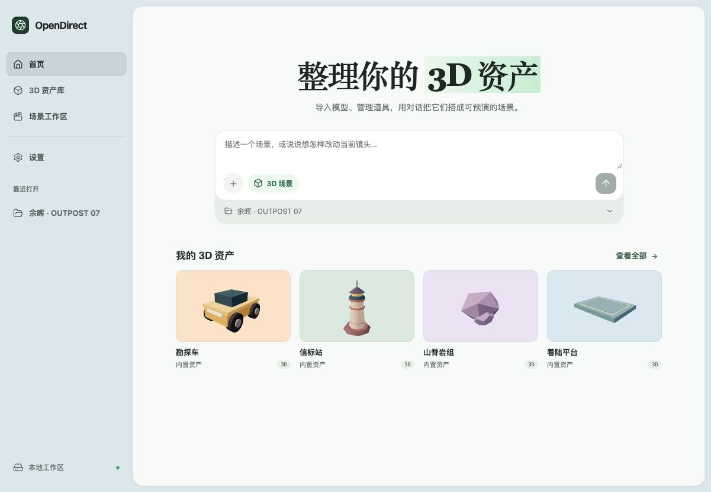

# OpenDirect

**先在 3D 里排好镜头，再生成视频。**

OpenDirect 是一个本地运行的开源 3D 资产工作台和 AI 视频导演客户端。你可以导入、预览和整理 GLB，复用资产搭建可编辑的 3D 场景，再把镜头的首尾帧或运动参考送进 ComfyUI。

[下载桌面版](https://github.com/CPPAlien/open-direct-video/releases) · [配置视频工作流](docs/comfyui.md)



[资产库界面](docs/library.jpg) · [场景工作区界面](docs/desktop.jpg)

## 快速开始

从 Releases 下载并解压 macOS Apple Silicon 构建。此构建没有 Apple 开发者签名及公证。如果系统拦截，或你使用其他平台，可以用 Node.js 22.19+ 从源码启动：

```sh
npm ci
npm run desktop
```

启动后可在首页进入 3D 资产库，浏览内置道具或导入不超过 40 MB 的自包含 GLB。资产支持搜索、重命名、下载及添加到场景。从左侧打开「余晖 · OUTPOST 07」，点击播放，或点击「降低相机机位」和发送，看 Agent 如何更新第一个镜头。可以直接修改对象位置、偏航角、颜色和镜头时长。工具栏可导出场景 JSON、含物体动画的 GLB，或 24 fps 的 WebM 预演。

## 接入模型

打开客户端右上角的设置。

- **导演模型**填 OpenAI 兼容地址和模型名。若使用 Ollama，地址通常是 `http://127.0.0.1:11434/v1`，模型需先在 Ollama 中拉取，并支持 JSON 响应。启用后可以用自由文本搭景、编排动作、修改镜头。不配置模型时，客户端提供两条示例指令，也支持选中对象后输入「移动到 2 1 3」或「把对象颜色改成 #ff8030」。
- **视频生成**填 ComfyUI 地址和已导出的 API 工作流 JSON 路径。选择时间线镜头、打开「生成视频」、填写成片描述并提交。配置和占位符见[工作流指南](docs/comfyui.md)。

项目、对话、任务 ID 和设置保存在本机。可以从应用菜单「帮助 → 打开项目目录」查看。API Key 如配置会写到该目录的本地设置文件，GUI 不回显。选择远程语言模型时会发送指令、场景和近期对话。选择远程 ComfyUI 或在工作流里使用云节点时，参考素材会交给相应服务。

## 实现

- **客户端**使用 Electron。窗口内运行 Three.js，支持场景查看、镜头切换、对象编辑和时间线播放。
- **Agent**只返回结构化场景操作。服务端先在候选场景上校验数据、检查相机离地高度和注视距离，并将失败原因返回给模型重试。验证通过后依据场景版本原子保存。
- **视频**由客户端从所选镜头采集参考画面，再由 ComfyUI 工作流生成。任务完成后可在客户端播放并下载。预演和生成视频分别呈现。
- 当前版本维护一个本地场景工作区。导入 GLB 以静态姿态加入场景，可在工作区为它编排新的位移动画。自由文本需要模型，可用的视觉风格和运动保真度取决于视频工作流。相机检查是几何规则，尚未接入视觉模型审片。

交互思路参考 Pavo 3D-BOX 的场景预演和镜头交付，以及 [OpenDesign](https://github.com/nexu-io/open-design) 的本地 Agent 工作台。项目独立实现。

## 开发

```sh
npm test         # 场景、Agent 和模拟 ComfyUI 的集成检查
npm run build    # 构建渲染界面
npm run desktop  # 启动桌面调试版
npm run package  # 打包当前平台的桌面应用，输出到 release/
```

代码以 [MIT](LICENSE) 发布。
